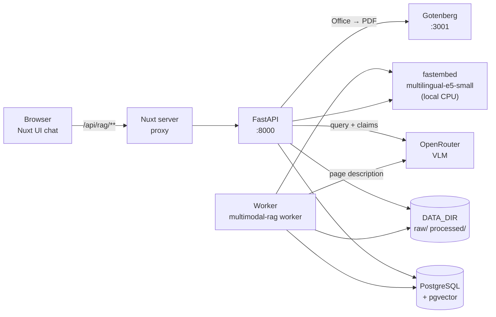

# Architecture

## Overview

Multimodal Document RAG answers questions about PDF, PPTX and XLSX files whose meaning is partly in text and partly in figures, tables and layout. Each page is indexed twice: once as extracted text and once as a description written by a vision-language model (VLM) that looked at the rendered page. Answers are split into claims, and every claim is checked against the sources it cites.

## Components

| Component | Location | Responsibility |
| --- | --- | --- |
| API | `src/multimodal_doc_rag/api.py` | HTTP interface: documents, jobs, page images, chat turns, pins, questions |
| Ingestion | `ingest.py` | Office to PDF conversion, page rendering, text and bounding-box extraction |
| Worker | `worker.py` | Durable queue consumer that describes and embeds pages |
| Embeddings | `index.py` | Chunking, local E5 embeddings, vector persistence |
| Retrieval | `retrieve.py` | Text and visual vector search, reciprocal-rank fusion, context assembly |
| Reader | `reader.py` | Query rewriting, page descriptions, claim drafting, verification |
| Figures | `figures.py` | Finds embedded images on a PDF page for cropped citations |
| Pipeline | `pipeline.py` | Ties rewrite, retrieval and reading together and times them |
| CLI | `cli.py` | `migrate`, `worker`, `doctor`, `ask`, `ingest`, evaluation commands |
| Frontend | `frontend/` | Nuxt 4 + Nuxt UI chat client |

## Process boundaries

- **API process** handles requests and does the cheap, synchronous part of ingestion (conversion, rendering, text extraction) at upload time. It also runs retrieval and answering inline. A chat request blocks on two or three OpenRouter calls.
- **Worker process** does the slow, billable part of ingestion: one VLM call per page plus embedding. It is separate so uploads and chat stay responsive and so work survives restarts.
- **PostgreSQL** is both the system of record and the job queue. There is no Redis or broker.

## Key design decisions

**Two views of every page.** Text extraction misses what is only in a chart or an image of a table; VLM descriptions are fuzzy about exact wording. Indexing both lets retrieval find a page by either, and lets the reader quote exact text or point at a figure.

**PostgreSQL as the queue.** Jobs are rows claimed with `FOR UPDATE SKIP LOCKED` and a lease timestamp. A crashed worker's lease expires and another worker resumes at the first unfinished page. This removes an infrastructure dependency at the cost of polling every 2 seconds.

**Local embeddings, remote generation.** `intfloat/multilingual-e5-small` (384 dimensions) runs on CPU through fastembed, so indexing and query embedding cost nothing per call and work offline after the first model download. Only page description and answering use OpenRouter.

**English retrieval queries.** The embedding model retrieves English documents poorly from Vietnamese queries. Every non-ASCII question is first rewritten into an English search query. The original question is still what the reader answers, in the asker's language.

**Verify instead of trust.** The model that drafts an answer is not trusted about its own citations. Quotes must appear verbatim in the retrieved text, and a second, independent model call decides whether each claim is supported. Anything unverified is shown as such rather than hidden.

**Deterministic figure boxes.** Asking a VLM for figure coordinates was unreliable (it copied example values from the prompt). Figure boxes are read from the PDF's image objects instead; the model's rough hint is used only to choose between several figures on one page.

## Technology

| Layer | Choice |
| --- | --- |
| Backend | Python 3.12, FastAPI, SQLAlchemy 2, Alembic, Typer |
| Database | PostgreSQL with pgvector (HNSW, cosine) |
| PDF | pypdfium2 (render, objects), Unstructured fast strategy (text, tables, boxes) |
| Office | Gotenberg (LibreOffice) |
| Embeddings | fastembed, `intfloat/multilingual-e5-small` |
| Generation | OpenRouter chat completions, default `qwen/qwen3-vl-8b-instruct` |
| Frontend | Nuxt 4, Nuxt UI 4, Vercel AI SDK types |

## Limits

- Up to 200 pages and 50 MB per upload (`MAX_DOCUMENT_PAGES`, fixed upload cap).
- Retrieval returns the top 3 pages per question.
- Only the last 6 turns, capped at about 12,000 characters, are used to resolve follow-up questions.
- Figure cropping needs embedded images; vector-only drawings fall back to the full page.
