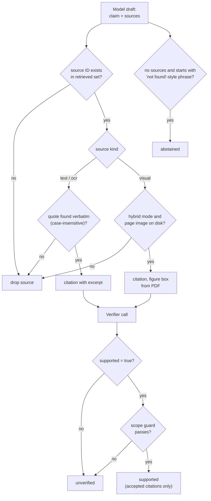

# Citations and verification

The reader's goal is that nothing appears as sourced unless the sources actually support it. This document describes how a drafted claim becomes `supported`, `unverified` or `abstained`.

## Statuses

| Status | Meaning | UI |
| --- | --- | --- |
| `supported` | At least one citation passed quote validation, the verifier and the scope guard | Claim followed by `[p.N]` buttons |
| `unverified` | The claim is shown but no citation was accepted | Yellow **Unverified** badge, no buttons |
| `abstained` | The model said it found nothing (no sources, text starts with "not found", "i could not find", "không tìm thấy" or "không có thông tin") | Plain text |

Only accepted citations are returned. A rejected citation is dropped, never shown with a warning.

## Stage 1: local source checks

For every proposed source:

- The ID must be one the server issued for this question.
- **Text and OCR sources:** the model's `quote` (up to 1,000 characters) must occur verbatim in the element text, ignoring case. The matched text from the source, not the model's version, becomes the citation `excerpt`. No quote means no citation.
- **Visual sources:** valid only in hybrid mode, and only if the page image file exists. The citation has no excerpt; the evidence is the image.

## Stage 2: independent verification

A second model call receives the original question, each claim and the text of each cited source (plus page images in hybrid mode). It is told to:

- check metric, language, population, units, denominator and time period;
- treat a number from a different metric or scope as *not* supporting the claim;
- require that a table value's column heading and metric label be visible, and that a named language or dataset be explicitly established by the source;
- return `{results: [{index, supported, source_ids}]}` and set `supported=false` when uncertain.

Only `supported: true` results with source IDs that were actually cited are considered. If this call fails or returns malformed data, nothing is promoted: all claims stay `unverified` and the answer is still returned.

## Stage 3: deterministic scope guard

`_direct_scope_guard` rejects accepted sources by rule, as a safety net against verifier mistakes:

- **Language.** If the question or claim names a language (Vietnamese, French, English, German, Chinese, Spanish, in English or Vietnamese) the source text must also mention it.
- **Metric.** If the question or claim names metrics such as `NDCG@5`, `Recall@10`, `Precision@k`, `Hit@k` or `MRR`, and the cited excerpt names metrics, they must overlap. If the excerpt names none but the page mentions more than one metric, the citation is rejected.

## Figure citations

For a citation from a visual source, the UI should show the figure rather than the whole page.

1. `figures.py` opens the original PDF (`data/processed/{id}/source.pdf` for Office files, otherwise `data/raw/{id}__*.pdf`) with pypdfium2.
2. It collects image and form objects on the page, converts their bounds to normalized top-left coordinates, merges overlapping boxes, and keeps boxes that are at least 8 % of the page in both dimensions and 2 % in area. Results are cached by file path, modification time and page.
3. `pick_figure` chooses the box. With one figure, that is it. With several, it takes the box that overlaps the model's rough `bbox` hint most, falling back to the largest.
4. The box is stored as the citation's `bbox`. If no embedded image is found (for example a vector drawing), `bbox` is `null` and the full page is shown.

The model's own `bbox` is validated by `_parse_bbox` (4 numbers, either 0-1 or 0-1000, at least 5 % per side, under 90 % of the page) but is never shown directly: asking a VLM for coordinates proved unreliable, so it only disambiguates between detected figures.

## Guarantees and limits

- Quotes shown to the user are always real substrings of the source.
- Verification reduces unsupported claims; it does not prove factual correctness. The verifier is another model.
- Figure citations point to the right *figure*, not to a specific value inside it.
- Verification and the scope guard add one OpenRouter call and some latency per answer.
- Claims in older chat turns created before inline citations show page buttons only.
