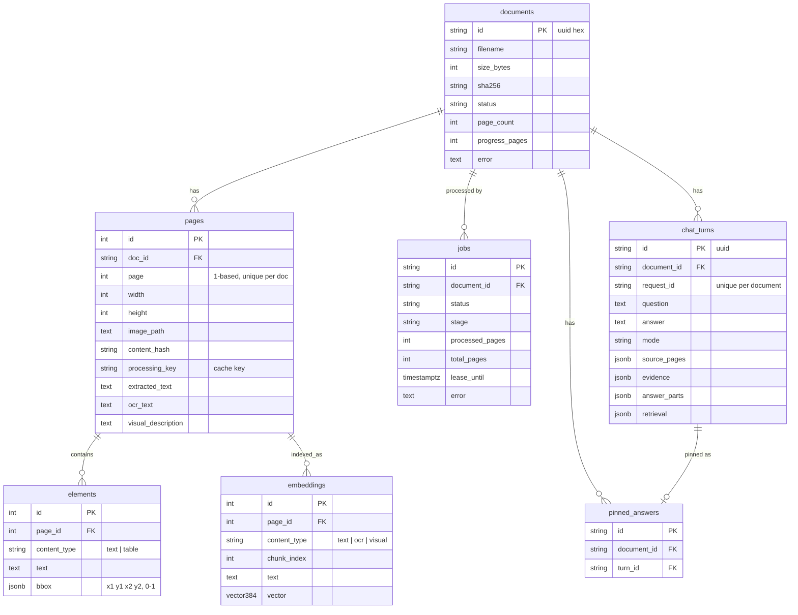

# Data model

## Entity relationships

All child tables use `ON DELETE CASCADE` from `documents`.

## Tables

- **`documents`**: one row per upload. `status` drives what the UI offers (see [ingestion-flow.md](ingestion-flow.md)). `sha256` is indexed but uploads are not deduplicated.
- **`pages`**: one per page, unique on `(doc_id, page)`. Holds the rendered image path, the text extracted from the PDF, the VLM's `ocr_text` and `visual_description`, and `processing_key`, the hash of image, text, model name and prompt version that the descriptions were produced under.
- **`elements`**: layout elements from extraction with normalized boxes. They are the *source of truth for exact quotes*; the retriever maps vector hits back to elements to give the reader whole, coherent text.
- **`embeddings`**: chunks of at most 450 characters from the three page texts, each with a 384-dimension vector. Deleted and rebuilt per page on re-indexing. HNSW index `ix_embeddings_vector_hnsw` with `vector_cosine_ops`.
- **`jobs`**: the work queue (see below).
- **`chat_turns`**: one row per question. `answer_parts`, `evidence` and `source_pages` are stored as JSONB exactly as returned to the client. Unique on `(document_id, request_id)` for idempotent retries.
- **`pinned_answers`**: unique on `(document_id, turn_id)`.

## Queue semantics

A job is runnable when `status = 'queued'`, or when `status = 'processing'` and `lease_until` is in the past. Claiming uses `SELECT ... FOR UPDATE SKIP LOCKED`, so concurrent workers never take the same job. The worker renews `lease_until` after each page.

## Files on disk (`DATA_DIR`, default `data/`)

| Path | Content |
| --- | --- |
| `raw/{document_id}__{filename}` | Original upload, never modified |
| `processed/{document_id}/source.pdf` | PDF converted from PPTX/XLSX (absent for PDF uploads) |
| `processed/{document_id}/page-0001.jpg` | Rendered pages (150 DPI, max 2048 px) |
| `evaluation/`, `qa/` | Evaluation inputs and results (git-ignored) |

`pages.image_path` stores the path as it was at processing time. Back up `DATA_DIR` together with the database; either alone is not restorable.

## Migrations

Alembic, in `migrations/versions/`. Run `multimodal-rag migrate`.

| Revision | Adds |
| --- | --- |
| `0001_full_flow` | documents, pages, elements, embeddings, jobs, pgvector extension |
| `0002_document_chat` | chat turns and pinned answers |
| `0003_inline_citations` | structured `answer_parts` on chat turns |

`create_schema()` in `models.py` creates tables directly for local experiments and tests; use migrations for real databases.

## Pydantic shapes

`schemas.py` defines the API and reader types: `ParsedElement`, `Citation` (`doc_id`, `page`, `excerpt`, `bbox`, `source_kind`), `AnswerPart` (`text`, `status`, `citations`), `Evidence`, `SourcePage` and `Answer`. A `bbox` is always `(x1, y1, x2, y2)` as fractions of page width and height with a top-left origin.
