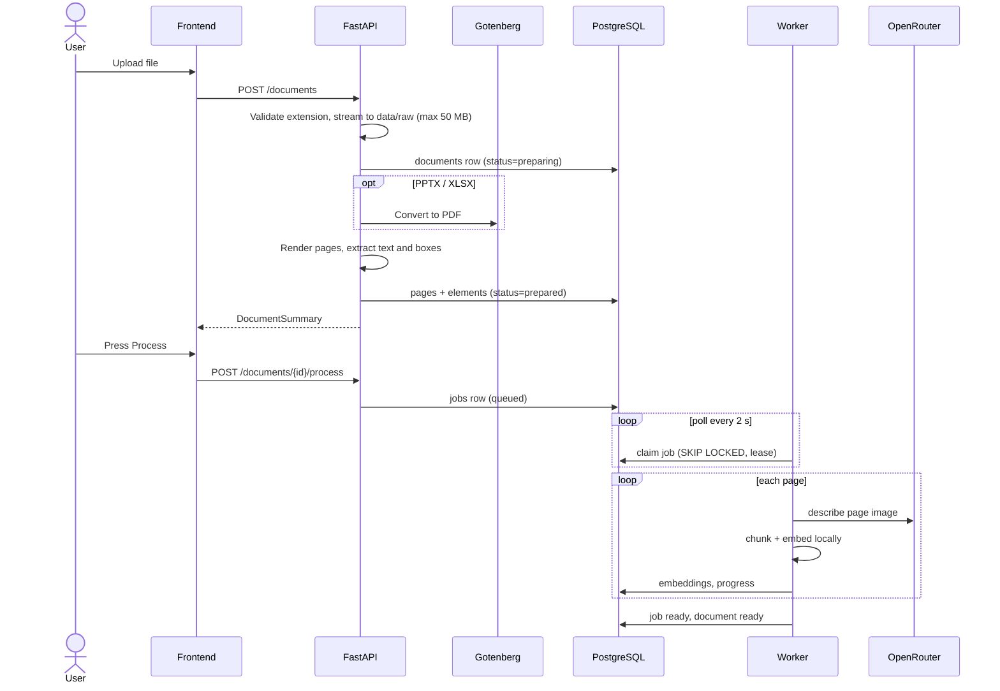

# Ingestion flow

Ingestion has two phases. **Preparation** happens inside the upload request and uses no external model. **Processing** is queued with **Process** and runs in the worker.

## Phase 1: preparation (upload)

`POST /documents` in `api.py` and `prepare_document` in `ingest.py`.

1. Only `.pdf`, `.pptx` and `.xlsx` are accepted (HTTP 415 otherwise). The file is streamed in 1 MB chunks to `data/raw/{document_id}__{filename}` while a SHA-256 is computed. Over 50 MB aborts with 413 and deletes the partial file.
2. A `documents` row is created with `status=preparing`.
3. `canonical_pdf` returns PDFs unchanged. Office files are posted to Gotenberg's LibreOffice route and the result is saved as `data/processed/{id}/source.pdf`. If Gotenberg is down the upload fails with a message to start it.
4. `_extract_elements` extracts text elements and normalized bounding boxes. It uses Unstructured's `fast` strategy when installed (tables are tagged `table`, boxes are divided by page size to give 0-1 coordinates). Without Unstructured it falls back to one text element per page from pypdfium2 and no boxes.
5. Each page is rendered to `data/processed/{id}/page-0001.jpg` at 150 DPI, capped at 2048 pixels on the long side, JPEG quality 88. A SHA-256 of the image becomes the page `content_hash`.
6. `pages` and `elements` rows are written and the document moves to `prepared` with `page_count` set.

Documents over 200 pages are rejected. Any failure after the file is stored sets the document back to `uploaded` with an `error` and returns 422.

If a document is somehow still unprepared when **Process** is pressed, `POST /documents/{id}/process` runs the same preparation first.

## Phase 2: processing (worker)

`POST /documents/{id}/process` creates a `jobs` row (`queued`) and sets the document to `queued`. It is idempotent: if a job is already `queued` or `processing`, that job is returned instead of creating another. It returns 409 while the document is still `uploaded` or `preparing`.

The worker (`worker.py`, `multimodal-rag worker`) loops:

1. **Claim.** `_claim_job` selects the oldest job that is `queued`, or `processing` with an expired `lease_until`, using `FOR UPDATE SKIP LOCKED`. It sets `processing/indexing` and a lease of `WORKER_LEASE_SECONDS` (default 300 s). Several workers can run safely.
2. **Warm up.** `initialize_embedding_model` loads the embedding model and checks that a Vietnamese and an English sample produce 384-dimensional, finite, L2-normalized vectors.
3. **Per page**, in order:
   - Compute a cache key from `content_hash`, a hash of the extracted text, the OpenRouter model name and `PROMPT_VERSION`.
   - If the page already has a description under this key **and** embeddings, skip it. This is how a resumed or re-run job avoids repeating work.
   - Otherwise reuse the description of any other page with the same key (identical page content across documents), or call `describe_page`.
   - `describe_page` sends the page image plus up to 12,000 characters of extracted text and asks for JSON with `ocr_text` (text missing from extraction, for scans) and `visual_description` (headings, tables, chart titles, axes, units, legible values). Up to 3 attempts with backoff on 429/5xx.
   - Store `ocr_text`, `visual_description` and `processing_key`.
   - `index_page` deletes the page's old embeddings, splits each of the three texts (`text`, `ocr`, `visual`) into chunks of at most 450 characters on word boundaries, embeds them with the `passage:` prefix and inserts `embeddings` rows.
   - Update `processed_pages`, `documents.progress_pages` and renew the lease.
4. **Finish.** If every page was indexed, the job becomes `ready/complete` and the document `ready`. Otherwise, or on any exception, the job and document become `failed` with the first 2,000 characters of the error.

## Status values

| Entity | Values |
| --- | --- |
| Document | `uploaded`, `preparing`, `prepared`, `queued`, `processing`, `ready`, `failed` |
| Job | `queued`, `processing`, `ready`, `failed` |
| Job stage | `queued`, `indexing`, `processing_pages`, `complete`, `failed` |

Chat requires the document to be `ready` (409 otherwise).

## Recovery and re-processing

- **Worker crash:** the lease expires after 5 minutes of no progress; another worker claims the job and resumes at the first page that lacks a description or vectors.
- **Failed job:** press **Process** again. A new job is created; pages already described under the same cache key are skipped.
- **Changing the model or prompt:** the cache key includes the model name and `PROMPT_VERSION` (`reader.py`). Changing either invalidates old descriptions and they are regenerated.
- **Changing the embedding model:** `EMBEDDING_MODEL` must produce 384 dimensions to fit the `vector(384)` column; other sizes need a migration.
