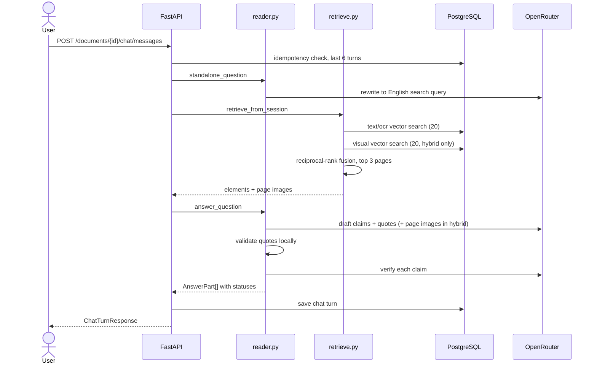

# Question answering flow

One chat message goes through query rewriting, retrieval, answer drafting and verification. The code path is `ask_detailed` in `pipeline.py`.



## 1. Request handling

`POST /documents/{id}/chat/messages` (`mode` is `hybrid` or `text`; anything else is 422).

- **Idempotency.** `request_id` is unique per document. A repeat of an earlier request returns the stored turn instead of calling the model again, so a retried network request is safe.
- The document must be `ready` (409 otherwise).
- Up to the last 6 turns, trimmed to about 12,000 characters total, are loaded as conversation history. Older text is cut first.
- A `RuntimeError` from OpenRouter becomes HTTP 503 with its message.

## 2. Query rewriting

`standalone_question` produces the text used for **retrieval only**.

- With no history and a pure-ASCII question, the question is used as is, with no model call.
- Otherwise the model rewrites it as one concise, standalone, **English** search question. It resolves references using prior turns, translates, and keeps names, metrics and numbers unchanged (for example "Hình 2" becomes "Figure 2").

Why English: the indexed text and the E5 embeddings work far better against an English query. The reader later receives the *original* question and answers in its language.

## 3. Retrieval

`retrieve_from_session` in `retrieve.py`.

1. Embed the rewritten query with the `query:` prefix.
2. **Text branch:** nearest 20 chunks of type `text` or `ocr` (cosine distance, HNSW index), restricted to the document and to `ready` documents.
3. **Visual branch** (hybrid only): nearest 20 chunks of type `visual`.
4. Collapse chunks to pages (first hit per page per branch) and fuse the two ranked page lists with reciprocal-rank fusion: `score = Σ 1 / (60 + rank)`.
5. Keep the top `top_k` pages (3 for chat; 1-5 for `POST /questions`).

### Building the reader context

For each selected page the retriever builds `ParsedElement`s, each tagged with a `source_kind` (`text`, `ocr` or `visual`):

- **Text elements.** Layout elements from the page that overlap a retrieved text chunk. Overlap means equal text, or one contains the other when both are at least 12 characters. The minimum stops table cells such as `-` or `45.0` from matching almost everything and flooding the context.
- **Visual elements** (hybrid only). Every `visual` chunk of the page, in order, not just the one that matched. A hit is often one fragment of a long description, and the fragment alone ("7.22s).") is useless to the reader.
- If no layout element matches, the retrieved chunks themselves are used.

Page images for the selected pages are returned alongside so the reader can see them.

## 4. Drafting the answer

`answer_question` in `reader.py`. Every element gets a server-assigned ID (`S1`, `S2`, ...). Model-written page numbers or IDs are never trusted.

The prompt sends each source with its `doc_id`, page and kind (text truncated to 4,000 characters), the prior conversation as *reference resolution only, not evidence*, and, in hybrid mode, the rendered page images. It requires JSON of the form:

```json
{"parts": [{"text": "one short standalone claim",
            "sources": [{"id": "S1", "quote": "exact source substring", "bbox": [x1, y1, x2, y2]}]}]}
```

Instructions that matter for quality:

- Use only the provided sources; never use a number as evidence for a different metric, population, language, unit or period.
- Write each claim in the language of the question; keep quotes verbatim in the source language.
- Answer with the specific facts asked for (names, steps, values) and cite the most specific source, such as a figure or table, rather than a background sentence.
- `bbox` is requested for `visual` sources, used only as a hint (see [citations-and-verification.md](citations-and-verification.md)).
- If the fact is absent, answer "Not found in the provided documents." (or the Vietnamese equivalent) with no sources.

Up to 12 claims are kept. If the model returns the legacy `{"answer": ...}` shape, it becomes one claim with no sources and therefore cannot be verified.

Text mode (`mode=text`) sends only text elements and no images; visual sources cannot be cited.

## 5. Verification and result

Quotes are validated locally, a second model call verifies each claim, and each part is labeled `supported`, `unverified` or `abstained`. Details are in [citations-and-verification.md](citations-and-verification.md).

The saved turn stores `answer` (claims joined by blank lines), `source_pages`, `evidence` (text excerpts with boxes), `answer_parts`, and `retrieval` metadata: mode, number of pages, end-to-end latency in milliseconds, and source pages.

## Cost and latency

A chat turn makes up to three OpenRouter calls: rewrite (non-ASCII or follow-up questions only), draft, and verify (skipped when no claim has a validated citation). Hybrid mode additionally uploads up to three page images on the draft and verify calls. Latency is recorded per turn in `retrieval.latency_ms`.

## Other entry points

- `POST /questions`: same pipeline across any set of documents, no history, nothing saved.
- `multimodal-rag ask "..." --mode hybrid`: the same from the CLI, printing the JSON answer.
- `baseline.py`: text-only reader used as an evaluation baseline.
